# Firmware Runtime Flows

## 1. Boot và network

```mermaid
sequenceDiagram
    participant Boot as app_main
    participant Settings as device_settings
    participant Key as Virtual key + LED sniffer
    participant Calibration as calibration flow
    participant WiFi as wifi_manager
    participant Time as time_manager
    participant MQTT as mqtt_manager
    participant App as Application tasks

    Boot->>Boot: init NVS
    Boot->>Settings: init()
    alt core_cfg chưa có/không hợp lệ
        Settings->>Settings: seed factory core config + readback
    else core_cfg hợp lệ
        Settings->>Settings: load node/MQTT config + command settings
    end
    Settings->>Settings: load last_price; missing is not a boot error
    Boot->>Key: start sniffer + init virtual key GPIO
    Boot->>Calibration: load cal_mode và mapping từ NVS
    Calibration->>Key: áp dụng lại raw_command, verify tối đa 3 lần
    Calibration-->>Boot: success hoặc log lỗi và tiếp tục
    Boot->>WiFi: start()
    WiFi->>WiFi: load credentials và connect STA
    WiFi-->>Boot: return ngay
    Boot->>Time: start SNTP manager
    Boot->>MQTT: init client bằng core_cfg từ NVS
    Boot->>App: start heartbeat/Totalizer view/status LED/keypad scan
    WiFi-->>Time: IP_EVENT_STA_GOT_IP
    Time->>Time: start/restart SNTP
    WiFi-->>MQTT: IP_EVENT_STA_GOT_IP
    MQTT->>MQTT: connect broker
    MQTT->>MQTT: subscribe command topic
    MQTT->>MQTT: set MQTT_READY
```

Không bước nào buộc `app_main()` chờ network. Khi Wi-Fi mất, MQTT ready bị clear; Wi-Fi và MQTT tự reconnect bằng timer/backoff.

OTA app chỉ thay nội dung `ota_0`/`ota_1`. Partition `nvs` riêng được giữ nguyên, nên boot sau OTA đi theo nhánh load cấu hình đã provision thay vì seed lại.

## 2. Sniffer LED

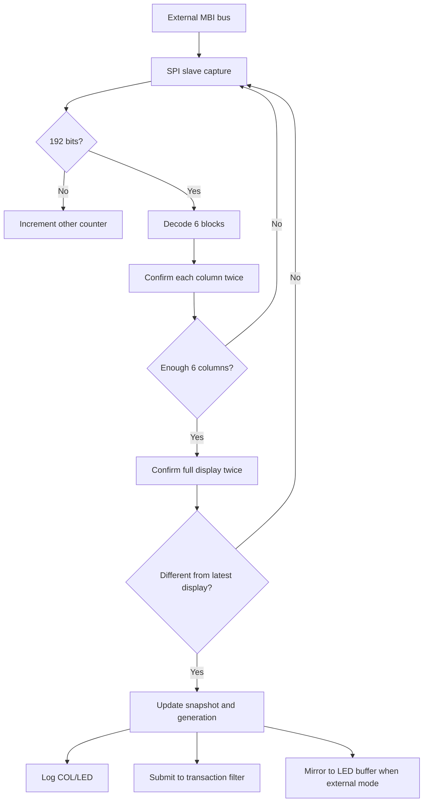

`s_display_observation_generation` tăng khi có một màn hình hoàn chỉnh được quan sát. `s_display_generation` và log chi tiết chỉ tăng/in khi nội dung đổi.

## 3. Nhận biết giao dịch bơm

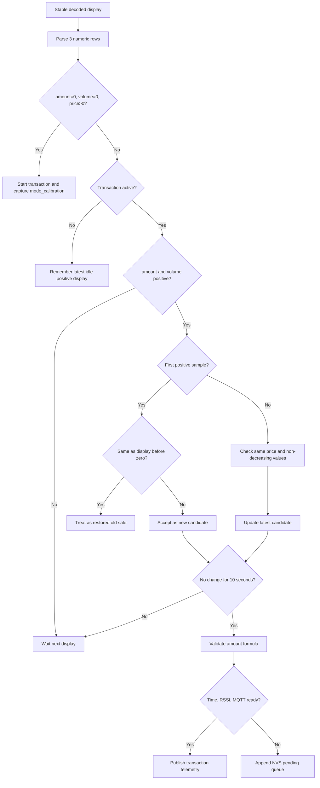

Nếu firmware bắt đầu khi màn hình đã ở `0/0`, không có màn hình cũ làm mốc, mẫu dương đầu tiên vẫn phải có thêm một bước tăng mới được coi là giao dịch.

## 4. Buffered transaction

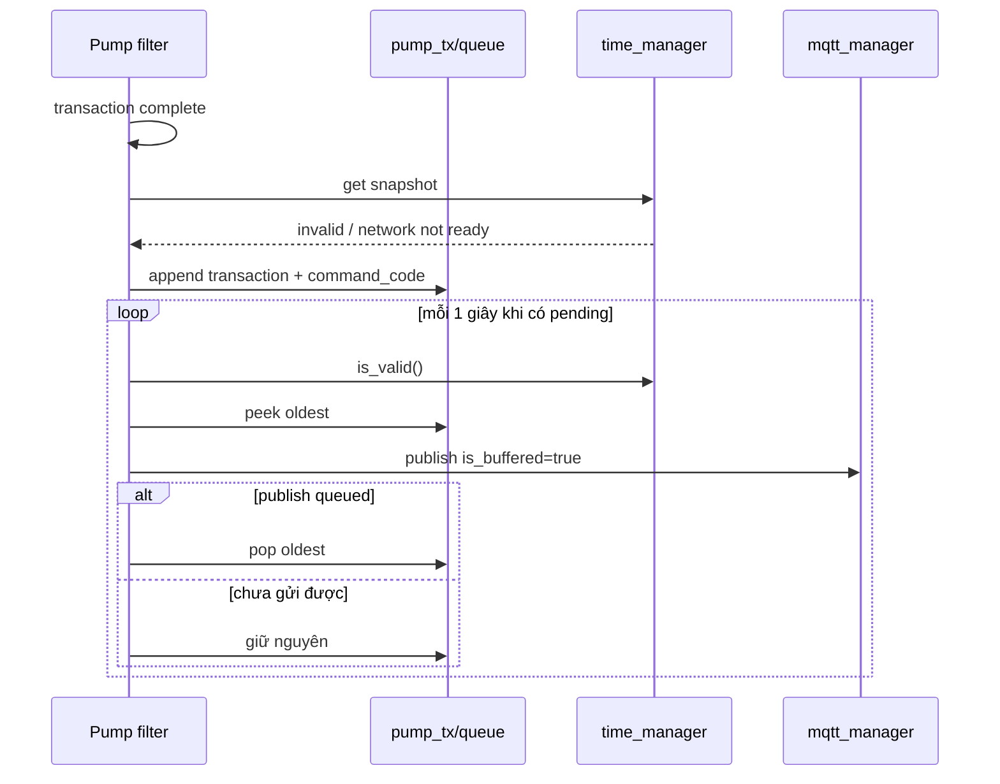

Queue FIFO tối đa 32 phần tử. Bản ghi hiện lưu tiền, lít, đơn giá và command code, chưa lưu timestamp gốc.

## 5. MQTT command

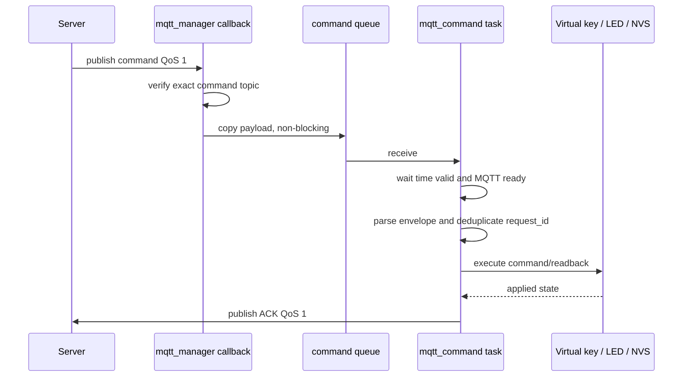

Command callback không chạy chuỗi phím. Công việc dài nằm trong command task.

## 6. Get Totalizer

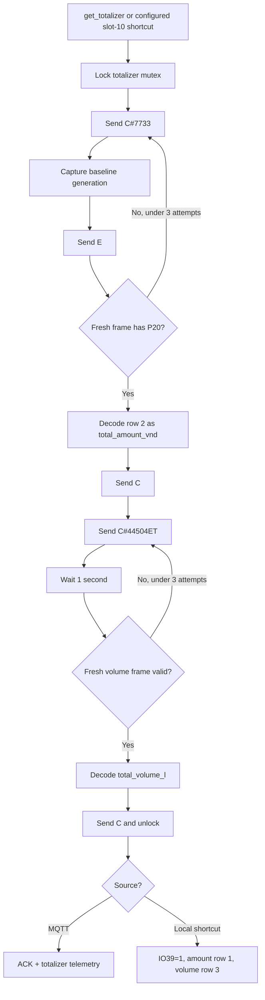

### 6.1 Ghép dữ liệu tổng tiền

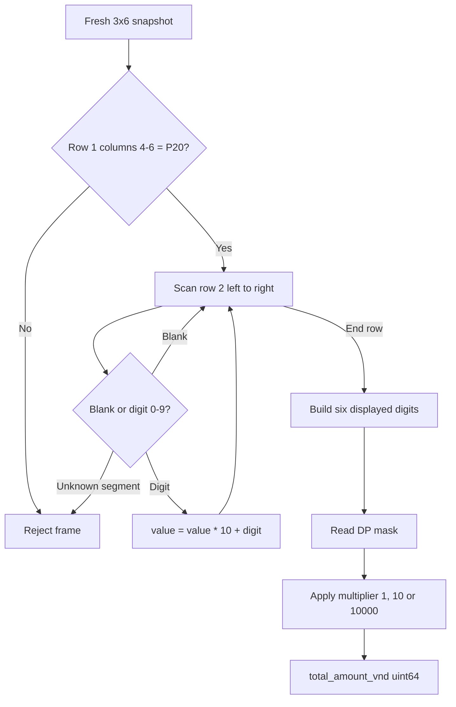

DP không thay đổi bản thân chữ số nhưng quyết định hệ số: cột 3 = `x1`, cột
1+4 = `x10`, không DP hoặc chỉ cột 1 = `x10000`. Sáu segment gốc được giữ lại
cho chế độ hiển thị local.

### 6.2 Ghép dữ liệu tổng lít

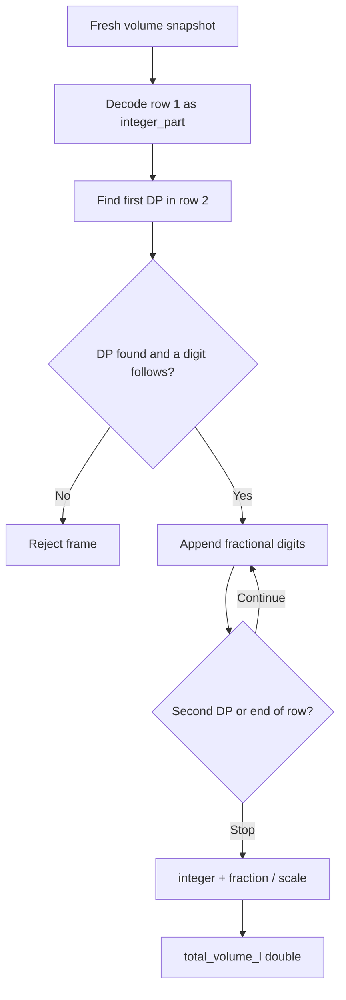

Ví dụ hàng 1 là `2`, hàng 2 có DP đầu tiên rồi chữ số `0`, sau đó gặp DP thứ
hai, kết quả là `2.0 L`.

### 6.3 Hiển thị local trên LED 3x6

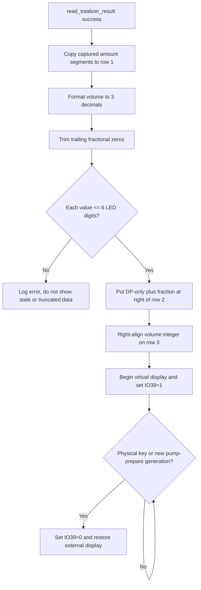

Shortcut Totalizer local lấy từ `shortcut_key_10` trong NVS. Firmware dùng
`P88` làm mặc định khi slot 10 chưa từng được cấu hình. Chỉ khi nhập đủ toàn
bộ chuỗi thì task Totalizer dùng chung mới được kích hoạt.

Trong chế độ Totalizer local, bất kỳ phím vật lý nào cũng yêu cầu thoát;
firmware trả IO39 về 0 và không dùng phím thoát để kích hoạt command khác.
Ngoài ra, nhánh `Bat dau luot bom` của `pump_transaction_filter` tăng một
`prepare_generation`. Nếu generation thay đổi vì LED decode nhận hàng tiền
`0` và hàng lít `0.00`/`0.000`, Totalizer tự thoát mà không cần người dùng
nhấn phím. Kiểm tra dùng generation thay vì chỉ giữ một cờ trạng thái nên
không bỏ lỡ màn hình chuẩn bị bơm tồn tại trong thời gian ngắn.

## 7. Set unit price

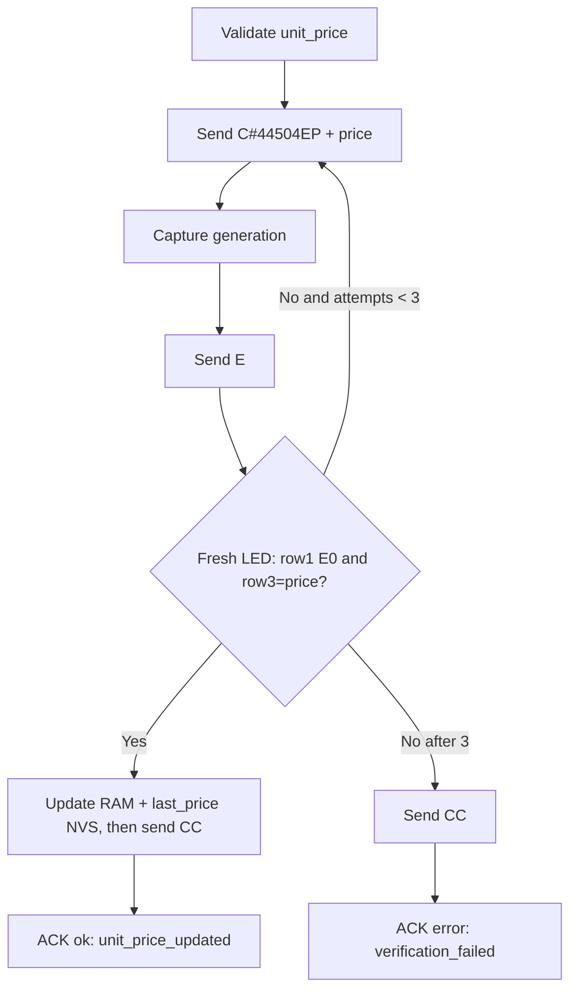

ACK được gửi sau khi thao tác và xác nhận LED hoàn tất, nên phản ánh kết quả cuối.

## 8. Heartbeat và cache đơn giá

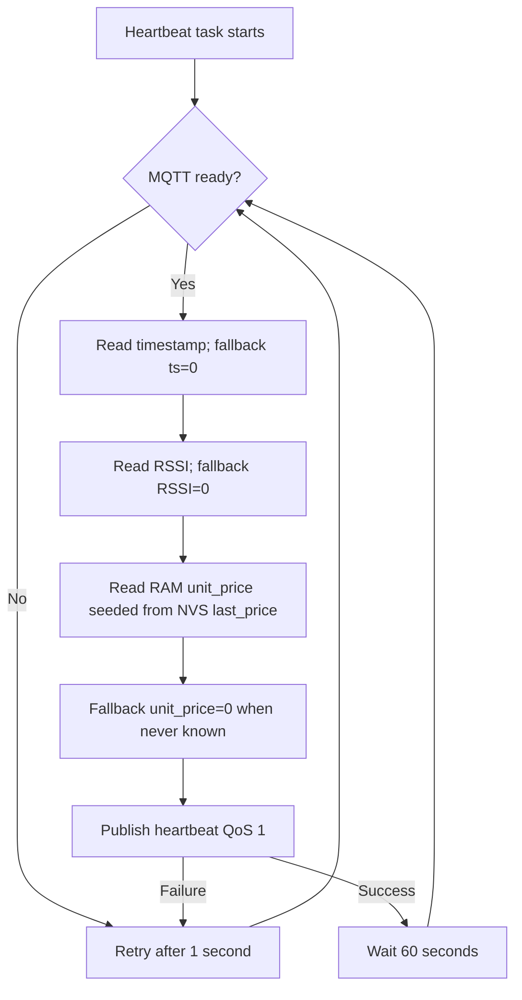

Khi sniffer giải mã được hàng 3 hợp lệ hoặc `set_unit_price` verify thành công,
firmware cập nhật cache RAM ngay. NVS `device_cfg/last_price` chỉ được commit và
readback nếu giá mới khác giá đã lưu, tránh ghi Flash theo từng frame LED.

## 9. Calibration

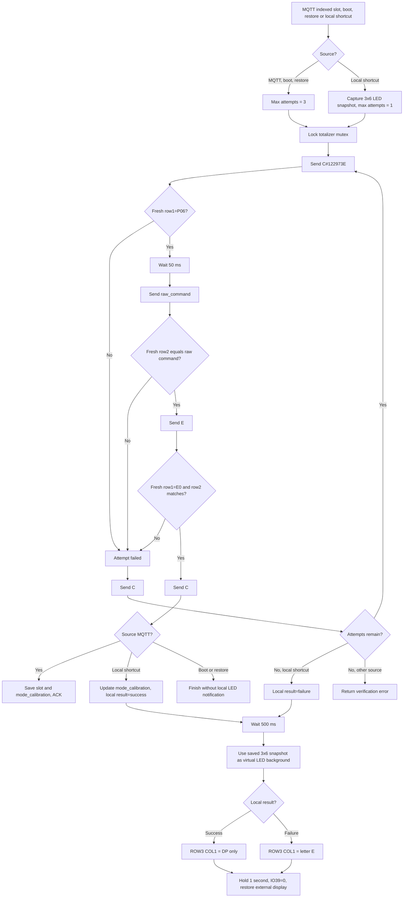

Virtual output được phân biệt với physical input nên không tự kích hoạt shortcut
lặp vô hạn. Snapshot được lấy trước khi màn hình bị chuỗi calibration thay đổi.
Totalizer local không được bắt đầu trong thời gian LED báo calibration local; trạng thái
Wi-Fi có quyền ưu tiên và có thể tiếp quản LED.

## 10. Wi-Fi Config Mode

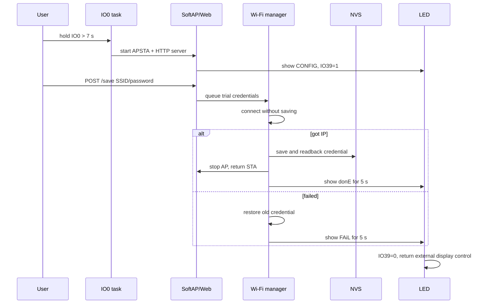

## 11. SNTP

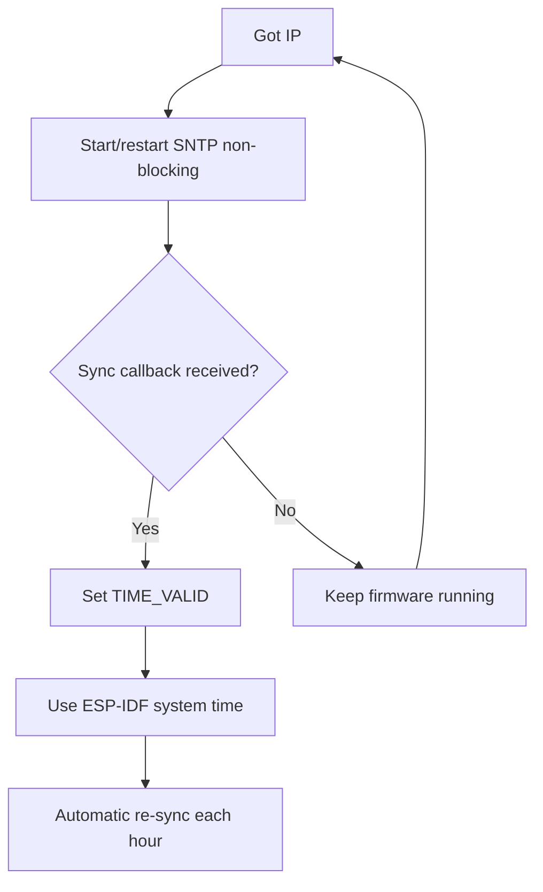

## 12. Thay đổi MQTT config an toàn

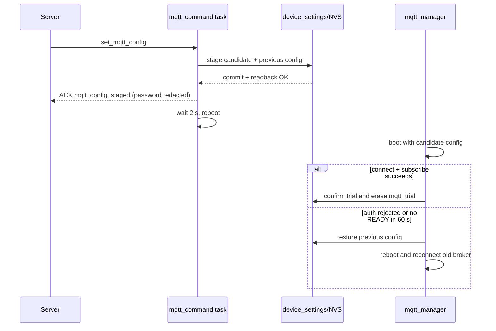

## 13. OTA

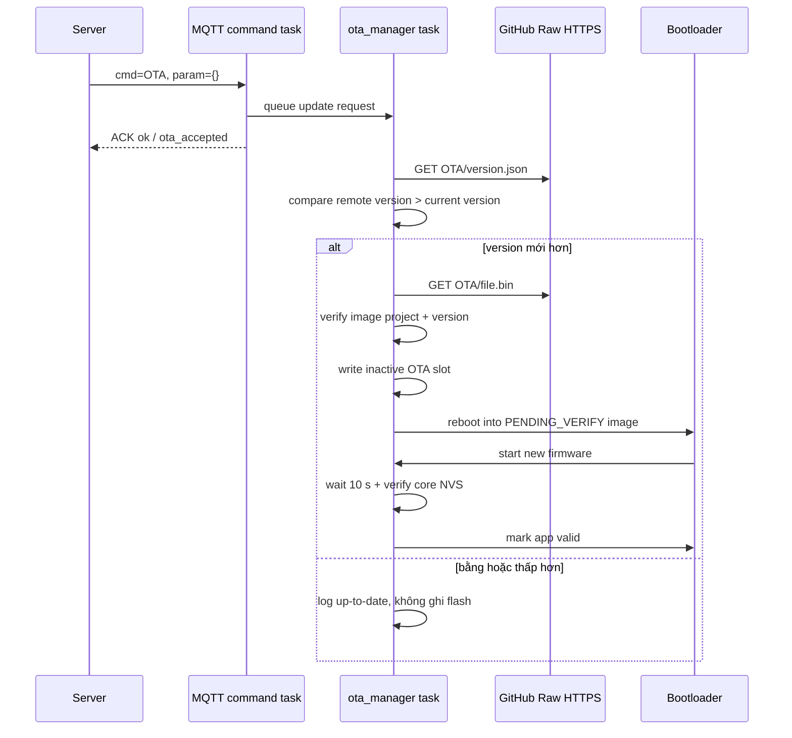

Nếu firmware mới reset/crash trước khi gọi mark-valid, bootloader chọn lại app slot hợp lệ trước đó. NVS không nằm trong app slot nên cấu hình thiết bị không bị thay bằng factory seed sau OTA.
